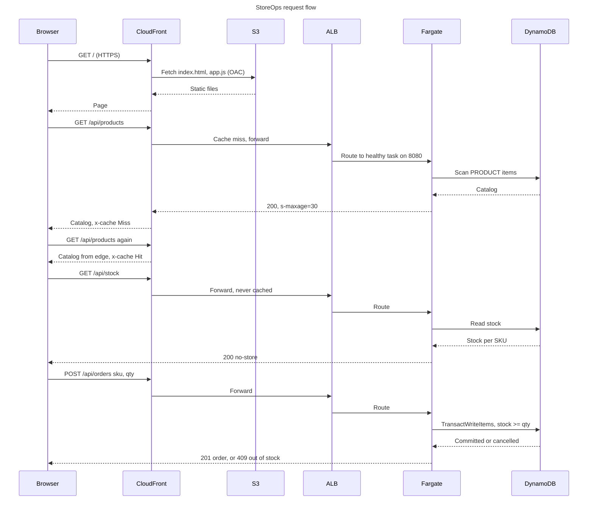

# 01 - Request flow (sequence)

How a shopper's browser talks to the system: page load, cached catalog, live stock, and placing an order. Source: `plan/01-sample-app.md` (API contract) and `plan/02-cdk-infrastructure.md` (edge behaviours).

Things to notice:

- Only `/api/products` is cached at the edge (30 s). Stock and orders always reach the API.
- Every response carries `x-served-by` (task id) and `x-app-version`, so `curl -i` shows load balancing and rolling deploys.
- `/api/health` is used only by the ALB and never touches DynamoDB.
