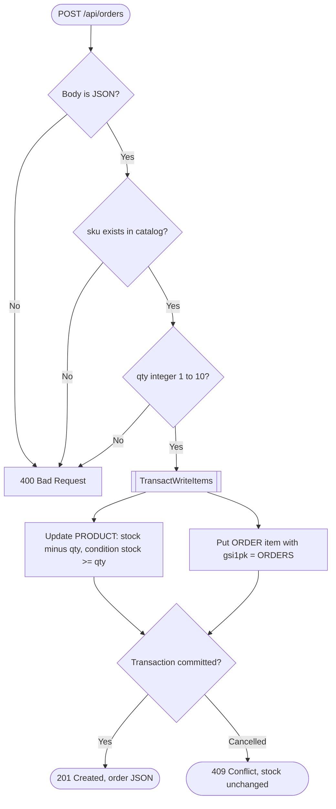

# 02 - Order placement logic (flowchart)

What `POST /api/orders` does, and which HTTP status each path returns. Source: `plan/01-sample-app.md`.

The memory store (used locally when `TABLE_NAME` is unset) follows the same rules, so the tests check one contract for both stores.
