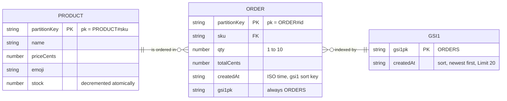

# 03 - Data model (ER diagram)

One DynamoDB table, on-demand, partition key `pk`, no sort key. Products and orders share the table; a global secondary index `gsi1` lists recent orders. Source: `plan/01-sample-app.md`.

In the table the attribute is literally named `pk`; the diagram calls it `partitionKey` because Mermaid reserves `pk` as the key marker.

Access patterns:

| Need | How |
|---|---|
| Catalog | Scan items with `pk` starting `PRODUCT#` (8 items) |
| Stock | Same items, `stock` attribute |
| Place order | `TransactWriteItems`: conditional `Update` on product + `Put` order |
| Latest 20 orders | Query `gsi1` where `gsi1pk = ORDERS`, newest first, `Limit 20` |
