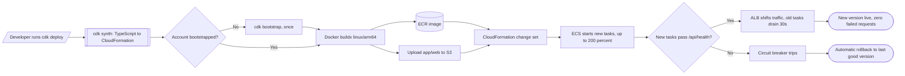

# 04 - Deploy pipeline (flowchart)

What happens between `cdk deploy` and a new version serving traffic, including the automatic rollback. Source: `plan/02-cdk-infrastructure.md` and `plan/03-deploy-and-verify.md`.

Prerequisites on the laptop: Node, Docker running, AWS credentials for account `811428812009` in `us-west-2`. If Docker is missing, deploy from the lab VS Code server.
