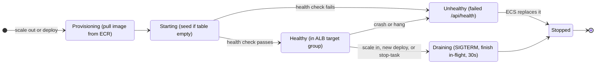

# 05 - Fargate task lifecycle (state diagram)

The states one API task goes through. This is what the self-healing, autoscaling, and zero-downtime demo beats show. Source: `plan/01-sample-app.md` (graceful shutdown) and `plan/02-cdk-infrastructure.md` (service settings).

The service keeps between 2 and 10 tasks running. When one stops for any reason, ECS starts a replacement to get back to the desired count.
