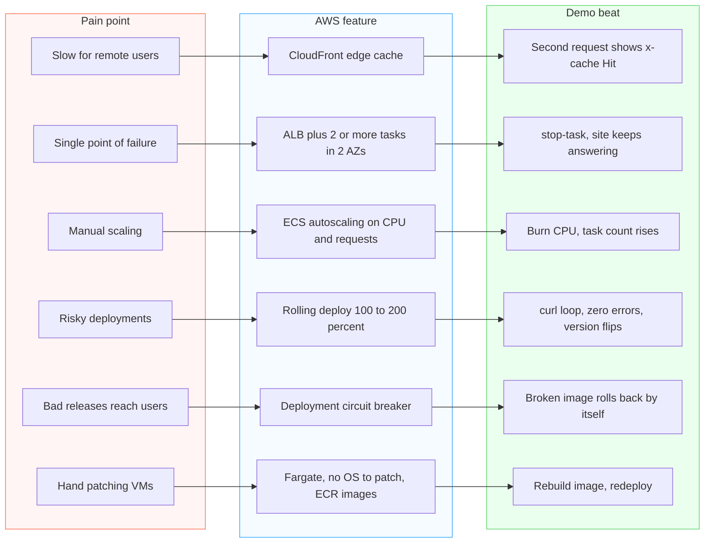

# 06 - Pain point to proof map (flowchart)

Each problem in the story, the AWS feature that answers it, and the live demo beat that proves it. Source: `plan/03-deploy-and-verify.md` (demo beats) and `plan/05-story-and-pitch.md`.

The cost pain points (virtualization licence renewal, data-center lease ending Q4 2027) are answered by the fleet cost model in the report, not by a demo beat. The pain point names come from the demo-beat table in `plan/03`; check them against the exact wording of the eight pain points in the brief.
