# 07 - Build timeline (Gantt)

The under-3-hour plan from `plan/00-overview.md`, using the time budget in each phase file. Times are elapsed time from start (00:00), not clock time. Phase 4 runs in parallel with phase 3.

```mermaid
gantt
    title Cloudathon build plan, elapsed time
    dateFormat HH:mm
    section Build
    P1 Sample app           :p1, 00:00, 30m
    P2 CDK stack            :p2, after p1, 40m
    section Ship
    P3 Deploy and verify    :p3, after p2, 35m
    P4 Diagram and report   :p4, after p2, 50m
    section Pitch
    P5 Story and pitch      :p5, after p4, 20m
    Rehearse demo           :r1, after p5, 10m
    Judging                 :milestone, after r1, 0m
```

Critical path: about 2 h 30 min (P1 + P2 + P4 + P5 + rehearsal). Phase 3 must finish before phase 5, because the demo run-sheet copies the commands that worked.
